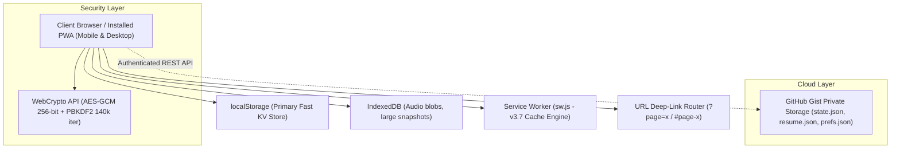
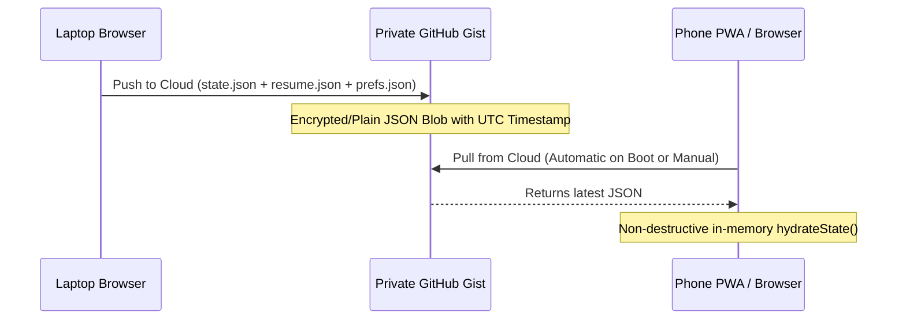

# System: Abhishikth — OS Dashboard ⚡
> **Personal Operating System · Academic Command HQ · Quant & DeepTech Career Engine**  
> *Crafted for Abhishikth (AIE · Amrita Vishwa Vidyapeetham, Chennai · 9.37 CGPA · AeroSynapse AI R&D Intern)*

[](#system-architecture)
[](#security--data-sovereignty)
[](#cloud-sync-phone--laptop)
[](#service-worker-cache-busting)

---

## 📑 Table of Contents
1. [Core Philosophy & Operating Principles](#-core-philosophy--operating-principles)
2. [System Architecture](#-system-architecture)
3. [Unified Navigation & Command Workspaces](#-unified-navigation--command-workspaces)
   - [Workspace 1: Command Cockpit (`Alt+1`)](#workspace-1-command-cockpit-alt1)
   - [Workspace 2: Academic Command HQ & Bunk Shield (`Alt+2`)](#workspace-2-academic-command-hq--bunk-shield-alt2)
   - [Workspace 3: The Forge & Technical Vault (`Alt+3`)](#workspace-3-the-forge--technical-vault-alt3)
   - [Workspace 4: Vitality OS (`Alt+4`)](#workspace-4-vitality-os-alt4)
   - [Workspace 5: Circle & Charter + Travel IRCTC (`Alt+5`)](#workspace-5-circle--charter--travel-irctc-alt5)
   - [Workspace 6: Quant Funnel & Career Pipeline (`Alt+6`)](#workspace-6-quant-funnel--career-pipeline-alt6)
4. [Deep Engines & Algorithms](#-deep-engines--algorithms)
   - [The "Bunk Shield" Real-Time Attendance Calculator](#the-bunk-shield-real-time-attendance-calculator)
   - [IRCTC 60-Day & Tatkal Dispatch Engine](#irctc-60-day--tatkal-dispatch-engine)
   - [Hunter Ranking, XP & Streak Engine](#hunter-ranking-xp--streak-engine)
   - [Interactive Resume HQ & ATS PDF Engine](#interactive-resume-hq--ats-pdf-engine)
5. [System Keyboard Shortcuts & Quick Navigation](#-system-keyboard-shortcuts--quick-navigation)
6. [Cloud Sync: Phone ↔ Laptop Syncing Guide](#-cloud-sync-phone--laptop-syncing-guide)
   - [Why Sync May Fail & How to Fix It in 2 Minutes](#why-sync-may-fail--how-to-fix-it-in-2-minutes)
   - [Manual Data Backups & Snapshots](#manual-data-backups--snapshots)
7. [Developer & Configuration Guide](#-developer--configuration-guide)
   - [File Map & Code Structure](#file-map--code-structure)
   - [How to Update Schedule & Time-Blocks](#how-to-update-schedule--time-blocks)
   - [How to Add / Edit Semester Courses](#how-to-add--edit-semester-courses)
   - [How to Modify Quant Targets & Project Lists](#how-to-modify-quant-targets--project-lists)
   - [State Migration Pattern (`hydrateState`)](#state-migration-pattern-hydratestate)
   - [Service Worker Cache Busting (`sw.js`)](#service-worker-cache-busting-swjs)
8. [Evolution Roadmap & Upcoming Consolidations](#-evolution-roadmap--upcoming-consolidations)

---

## 🎯 Core Philosophy & Operating Principles

1. **Sub-60-Second Daily Friction:**  
   Tracking must never compete with execution. A personal OS should take less than 60 seconds a day to update, directing 99% of cognitive bandwidth into building low-latency C++ systems, studying algorithms, and publishing research.
2. **Emotional & Practical Thinking:**  
   Ambition in AI systems and quantitative finance is fueled by groundedness in family, deep friendships, and self-care — never at their expense.
3. **No Moving Goalposts:**  
   Celebrate and honor milestones achieved (commercial revenue at 18, edge-AI models deployed for Union Home Minister VIP security with AeroSynapse, IIT Madras research collaboration, and 9.37 CGPA at Amrita) before chasing next horizons.
4. **The Biological Cooling Engine:**  
   Unhurried time with family and close friends is not "lost work time" — it is the essential biological cooling system that prevents mental burnout.
5. **Physical Longevity as an Algorithmic Asset:**  
   Commitment to the dermatology protocol and 3-Run / 3-Gym split is an investment in energy, stamina, and lifelong compounding.

---

## 🏛 System Architecture

The dashboard is engineered as an **offline-first, zero-dependency, ultra-low-latency progressive web application (PWA)**:



* **Zero Build Step:** Native ES2022 JavaScript, responsive CSS Grid/Flexbox, and semantic HTML5 in [`index.html`](file:///c:/PROJECTS/VIBE/ROADMAP/tracker/index.html).
* **Deep-Linking & Routing Engine:** Resilient dual-mode routing supporting clean search parameters (`?page=trips`, `?page=semester`, `?page=routine`) and hash fragments (`#page-trips`).
* **Non-Destructive In-Memory Re-render:** Live cloud sync pulls update the UI reactively in place without destructive `window.location.reload()` loops.
* **Security & Data Sovereignty:** Optional client-side AES-GCM 256-bit encryption. The GitHub token and unencrypted data never leave your device unencrypted if a PIN lock is configured.

---

## 🧭 Unified Navigation & Command Workspaces

The navigation is divided into **6 high-impact workspaces** (accessible with `Alt+1` through `Alt+6` or the desktop sidebar):

### Workspace 1: Command Cockpit (`Alt+1`)
* **Today Cockpit (`#page-today` | `?page=today`):**  
  * Real-time clock, current period tracker (e.g. `Classes in Session · Next: P8 Folio Lock`), dynamic Hunter Rank badge, and daily quest checklist.
  * XP Progress Bar, active day streak counter with fire multiplier.
  * Quick-Log Spent Bar, 1-Tap Exam / Field Log, and expandable System Analytics & Pomodoro timer.
* **Daily Matrix (`#page-schedule` | `?page=schedule`):**  
  * Hour-by-hour time-blocked timetable tailored to Amrita AIE Sem 4 schedule.
  * P1–P8 class slots (08:25 AM – 04:10 PM) + Evening Deep Work & Gym slots.
* **Weekly Audit (`#page-audit` | `?page=audit`):**  
  * End-of-week reflection engine: study hours, LeetCode/Codeforces count, attendance delta, and qualitative retrospective.

---

### Workspace 2: Academic Command HQ & Bunk Shield (`Alt+2`)
* **Academic Command HQ (`#page-semester` | `?page=semester`):**  
  * **Top View Switcher Pills:** `[⚡ All-in-One]` | `[📚 Courses & Shield]` | `[📅 Academic Cal]`.
  * **Amrita Sem 4 Core Courses:**
    * `22AIE211` — Deep Learning
    * `22AIE212` — Operating Systems (Processes, scheduling, virtual memory, POSIX)
    * `22AIE213` — Design and Analysis of Algorithms (Divide & conquer, greedy, DP, graph theory)
    * `22MAT220` — Mathematics for Computing 4 (Stochastic processes, Markov chains, random variables)
    * `22AIE214` — Embedded Systems & Edge AI
  * **The Real-Time "Bunk Shield":** Configurable attendance margin calculator with instant toggle between `75% Min` and `80% Safe Zone`.
  * **Academic Calendar & Strategic Placement Radar:** Monthly interactive grid, holiday dates, Mid-Term/End-Term countdowns, and Placement Preparation timelines.

---

### Workspace 3: The Forge & Technical Vault (`Alt+3`)
* **Systems Roadmap (`#page-roadmap` | `?page=roadmap`):**  
  * 4-Phase strategic roadmap from C++ internals to edge AI, low-latency concurrent systems, and HFT quant execution.
* **R&D & Wins Vault (`#page-projects` | `?page=projects`):**  
  * **AeroSynapse DeepTech:** Government-supported edge video analytics pipeline (150+ FPS, YOLOv8 + custom Kalman tracker, TensorRT INT8/FP16).
  * **Satyam News Platform:** Real-world commercial software delivery (₹20,000 revenue at 18) with PostgreSQL ePaper engine.
  * **System: Engineer:** Gamified mobile application inspired by hunter ranking systems.
* **DSA Track (`#page-dsa` | `?page=dsa`):**  
  * LeetCode & Codeforces problem solve ledger with difficulty breakdowns, tag filters, and rating target lines.
* **Missions (`#page-missions` | `?page=missions`):**  
  * Daily micro-quests and long-term epic milestones with countdown timers and reward XP.
* **Folio Notes (`#page-notes` | `?page=notes`):**  
  * Tabbed markdown notebook for systems programming, mathematics, algorithms, and deep learning notes with instant autosave (`Ctrl+S`).

---

### Workspace 4: Vitality OS (`Alt+4`)
* **Vitality Command Center (`#page-routine` | `?page=routine`):**  
  * Consolidates physical fitness, dermatological care, biometrics, and mental state into **one high-performance dashboard**.
  * **View Switcher:** `[⚡ All-in-One]` | `[🏃 3-Run / 3-Gym]` | `[🩺 Biometrics]` | `[🧠 Mind & Circle]`.
  * **Workout Arena:** Today's routine (Push, Pull, Legs vs Run) with interactive pip sets (`1`, `2`, `3`, `4`).
  * **Daily Derma Checklist:** Morning & evening non-negotiable skin health checklist.
  * **Biometrics Trackers:** Weight (kg), sleep hours, steps, and interactive water intake ledger with `+0.25L` / `-0.25L` quick buttons.
  * **Mind & Circle:** Mood, stress, and cognitive load sliders + **Conversation Reminders & Intentions** (Family check-ins, campus squad catchups).

---

### Workspace 5: Circle & Charter + Travel IRCTC (`Alt+5`)
* **Circle & Charter (`#page-charter` | `?page=charter`):**  
  * Non-negotiable personal philosophy anchors and grounded life principles.
  * Friendship & Family Task Ledger with unhurried relationship commitments.
  * "Toggle Present Mode" for clean projection and reflection.
* **Travel & IRCTC Dispatch (`#page-trips` | `?page=trips`):**  
  * Complete home journey and conference travel planner.
  * Calculates exact **60-day advance IRCTC booking dates** (08:00 AM IST sharp) and Tatkal backup windows.
  * 1-Click `.ics` download and Google Calendar event exports.
  * Trip expense ledger and baggage packing checklists.

---

### Workspace 6: Quant Funnel & Career Pipeline (`Alt+6`)
* **Quant Funnel (`#page-targets` | `?page=targets`):**  
  * Target tier breakdown:
    * *Tier 1 Reach:* Jane Street, Citadel Securities, Optiver, Two Sigma, HRT.
    * *Primary Domestic Targets:* Graviton Research Capital (₹80L–1.2 Cr), Tower Research Capital (₹50–90 LPA), QuadEye (₹75L–1.2 Cr), WorldQuant BRAIN (₹20–50 LPA).
    * *Core Systems / Fallback:* D. E. Shaw, Google, high-throughput Fintech infra.
  * Quantitative skills matrix: low-latency C++20, order book mechanics, cache-line optimization, lock-free concurrency.
* **Applications Kanban (`#page-applications` | `?page=applications`):**  
  * Drag-and-drop / stage pipeline for internship applications: `Drafting` $\rightarrow$ `Applied` $\rightarrow$ `OA / Test` $\rightarrow$ `Interviewing` $\rightarrow$ `Offer`.
* **Personal Budget (`#page-budget` | `?page=budget`):**  
  * Monthly allowance, food, transit, study materials, and trip spending tracker.
* **Interactive Resume HQ (`#page-resume` | `?page=resume`):**  
  * Live-editable ATS-optimized single-page resume with instant clean browser print / PDF export (`Print / PDF` button).

---

## ⚡ Deep Engines & Algorithms

### The "Bunk Shield" Real-Time Attendance Calculator

Amrita Vishwa Vidyapeetham enforces strict attendance rules (75% minimum, 80% recommended buffer). The Bunk Shield calculates exact margins per course in real time:

$$\text{Attendance Percentage } P = \left( \frac{\text{Attended}}{\text{Total}} \right) \times 100$$

1. **When Attendance $\ge \text{Target}$ ($P \ge 75\%$ or $80\%$):**  
   Calculates how many upcoming classes you can safely miss while remaining at or above the threshold:
   $$\text{Safe to Miss} = \left\lfloor \frac{\text{Attended} - T \times \text{Total}}{T} \right\rfloor \quad \text{where } T \in \{0.75, 0.80\}$$
   *Displays:* **`🛡️ Safe to miss: N classes`** (Green badge).

2. **When Attendance $< \text{Target}$ (Danger Zone):**  
   Calculates the exact number of consecutive upcoming classes you must attend without missing to recover:
   $$\text{Must Attend} = \left\lceil \frac{T \times \text{Total} - \text{Attended}}{1 - T} \right\rceil$$
   *Displays:* **`🚨 Must attend: N consecutive classes`** (Red alert badge).

---

### IRCTC 60-Day & Tatkal Dispatch Engine

Indian Railways allows booking general reserved tickets **60 days in advance** (opening at 08:00 AM IST, excluding the date of journey):

$$\text{Booking Opening Date} = \text{Journey Date} - 60 \text{ Days}$$
$$\text{1-Day Advance Reminder} = \text{Journey Date} - 61 \text{ Days (Evening Prior)}$$
$$\text{Tatkal Opening Date} = \text{Journey Date} - 1 \text{ Day (AC at 10:00 AM, Non-AC at 11:00 AM)}$$

The engine computes live countdown timers, generates calendar alarms for 07:55 AM IST (5 minutes prior to window opening), and exports structured `.ics` files.

---

### Hunter Ranking, XP & Streak Engine

* **Rank Tiers:** `E-Rank` $\rightarrow$ `D-Rank` $\rightarrow$ `C-Rank` $\rightarrow$ `B-Rank` $\rightarrow$ `A-Rank` $\rightarrow$ `S-Rank` $\rightarrow$ `Monarch`.
* **XP Sources:**
  * Daily habits (Run, Derma, Water, Lights out): $+15$ to $+20$ XP each.
  * Completed timetable lecture / study block: $+15$ XP.
  * Solved DSA problems: Easy ($+15$ XP), Medium ($+35$ XP), Hard ($+75$ XP).
  * Project commits / milestones: $+50$ to $+100$ XP.
* **Streak Multiplier:** Consecutive daily logins boost XP by $1.0\times$ up to $2.5\times$ for sustained discipline.

---

## ⌨️ System Keyboard Shortcuts & Quick Navigation

| Shortcut | Action | Scope |
| :--- | :--- | :--- |
| <kbd>Alt</kbd> + <kbd>1</kbd> | Switch to **Workspace 1: Command Cockpit** | Global |
| <kbd>Alt</kbd> + <kbd>2</kbd> | Switch to **Workspace 2: Academic Command HQ** | Global |
| <kbd>Alt</kbd> + <kbd>3</kbd> | Switch to **Workspace 3: The Forge & Technical Vault** | Global |
| <kbd>Alt</kbd> + <kbd>4</kbd> | Switch to **Workspace 4: Vitality OS** | Global |
| <kbd>Alt</kbd> + <kbd>5</kbd> | Switch to **Workspace 5: Circle & Charter / Travel** | Global |
| <kbd>Alt</kbd> + <kbd>6</kbd> | Switch to **Workspace 6: Quant Funnel & Career** | Global |
| <kbd>Ctrl</kbd> + <kbd>B</kbd> | **Toggle / Collapse Sidebar** (Smooth floating pill) | Global (Desktop) |
| <kbd>Ctrl</kbd> + <kbd>Shift</kbd> + <kbd>N</kbd> | Open / Close **Quick Scratchpad** | Global |
| <kbd>Ctrl</kbd> + <kbd>S</kbd> | Save Current Folio Note | Notes Page |
| <kbd>Ctrl</kbd> + <kbd>Z</kbd> | Undo Last Task Checkbox Action | Global |
| <kbd>Enter</kbd> (in Terminal) | Execute HUD Terminal Command (`/help`, `/dsa`, etc.) | Sidebar Terminal |

---

## ☁️ Cloud Sync: Phone ↔ Laptop Syncing Guide

The application syncs between your phone and laptop using a private **GitHub Gist**:



### Why Sync May Fail & How to Fix It in 2 Minutes

1. **Different Gist IDs on Phone vs. Laptop (Root Cause #1):**
   * If you pushed from your laptop with an empty Gist ID field, GitHub generated Gist `A`.
   * If you pushed from your phone with an empty Gist ID field, GitHub generated Gist `B`.
   * **Fix:** Open Settings ⚙️ on your laptop, copy the **Gist ID**, open Settings on your phone, paste the **exact same Gist ID**, and tap **Save Settings**.
2. **Missing Token or "Remember Token" Unchecked:**
   * Mobile browsers clear temporary storage on exit.
   * **Fix:** In Settings, enter your GitHub PAT (`ghp_...`), make sure **"Remember Token on this device"** and **"Enable Auto Sync"** are both checked, and click **Save Settings**.
3. **Token Permission Scope:**
   * Your GitHub PAT must have the **`gist`** scope enabled.

### Manual Data Backups & Snapshots
* **Export JSON:** Settings ⚙️ $\rightarrow$ **Backup Data (JSON)** creates an immediate offline backup file of your complete system state.
* **Import JSON:** Settings ⚙️ $\rightarrow$ **Restore Data (JSON)** restores the full profile from disk.
* **Pre-Sync Snapshot:** Before pulling any cloud data that overwrites local state, the system automatically archives a snapshot in memory. Tap **↩️ Restore Pre-Sync Snapshot** if a pull ever replaces changes you made offline.

---

## 🛠 Developer & Configuration Guide

### File Map & Code Structure

```
c:\PROJECTS\VIBE\ROADMAP\tracker\
├── index.html          # Application shell (UI markup, layout, CSS, and reactive engine)
├── data.js             # Data Layer (DEFAULT_SCHEDULE, DEFAULT_SUBJECTS, targets, projects, calendar)
├── sw.js               # Service Worker (Offline asset caching v3.9 & background sync)
├── manifest.json       # Progressive Web App manifest (Icons, themes, orientation)
├── icons/              # PWA app icons (192x192, 512x512)
└── README.md           # System documentation and architecture blueprint
```

### How to Update Schedule & Time-Blocks
Locate `DEFAULT_SCHEDULE` in [`data.js`](file:///c:/PROJECTS/VIBE/ROADMAP/tracker/data.js) (approx. line 3950). Days are mapped from `Monday` through `Sunday`:
```javascript
{
  t: '08:25–09:15',
  n: '22AIE212 Operating Systems',
  d: 'P1 — Processes, threads & scheduling',
  tags: ['blue'],
  xp: 15,
  id: 'mon-0'
}
```

### How to Add / Edit Semester Courses
Locate `DEFAULT_SUBJECTS` in [`data.js`](file:///c:/PROJECTS/VIBE/ROADMAP/tracker/data.js) (approx. line 4100):
```javascript
{
  name: 'Operating Systems',
  code: '22AIE212 — processes, scheduling, virtual memory, POSIX',
  pri: 'Critical',
  pclass: 'pri-c',
  res: 'Silberschatz + OSTEP (Remzi) + CodeVault',
  res2: 'Write custom malloc & thread pool — HFT firms test this'
}
```

### State Migration Pattern (`hydrateState`)
When introducing any new property to `S` (the global state store), always provide a safe default in `hydrateState()`:
```javascript
function hydrateState() {
  if (!S.profile) S.profile = Object.assign({}, DEFAULT_PROFILE);
  if (!S.subjects) S.subjects = JSON.parse(JSON.stringify(DEFAULT_SUBJECTS));
  // Add new field fallback:
  if (!S.myNewFeature) S.myNewFeature = [];
}
```

### Service Worker Cache Busting (`sw.js`)
Whenever updating [`index.html`](file:///c:/PROJECTS/VIBE/ROADMAP/tracker/index.html), always increment `CACHE_NAME` in [`sw.js`](file:///c:/PROJECTS/VIBE/ROADMAP/tracker/sw.js):
```javascript
const CACHE_NAME = 'os-dashboard-v3-7'; // Bump version to force PWA refresh
```

---

## 🗺 Evolution Roadmap & Upcoming Consolidations

The system is actively progressing through architectural consolidation to minimize navigational fatigue:

* [x] **Phase 1: Vitality OS Consolidation (Completed)**
  * Merged `Daily Routine`, `Physical Metrics`, and `Mental State` into a unified hub.
  * Stripped cognitive distraction (`Gaming Lounge`).
* [x] **Phase 2: Academic Command HQ & Bunk Shield (Completed)**
  * Unified course readiness with Amrita attendance buffer math (`75% Min` / `80% Safe Zone`).
  * Integrated the Academic Calendar and Placement Countdown Radar.
* [x] **UI Polish & Navigation Modernization (Completed)**
  * Restored uniform DOM layout depth across all 16 pages.
  * Replaced blurry toggle button with crisp floating circular pill and vector SVG chevron.
  * Bound <kbd>Ctrl</kbd> + <kbd>B</kbd> hotkey for rapid desktop sidebar toggling.
  * Fixed cloud auto-sync loop and enabled instant reactive re-rendering.
* [ ] **Phase 3: Today Cockpit Consolidation (Planned)**
  * Merge `#page-schedule` (Daily Matrix) directly into `#page-today` via an inline **[List View | Time-Block Matrix]** switch.
* [ ] **Phase 4: Quant Funnel & Career Pipeline (Planned)**
  * Merge `#page-targets` with `#page-applications` into a unified Quant Funnel command center.
* [ ] **Phase 5: Forge Vault & Folio Integration (Planned)**
  * Link engineering project cards directly to their corresponding Folio subject notes.

---

*System: Abhishikth · Built for maximum execution velocity and biological sustainability.*
